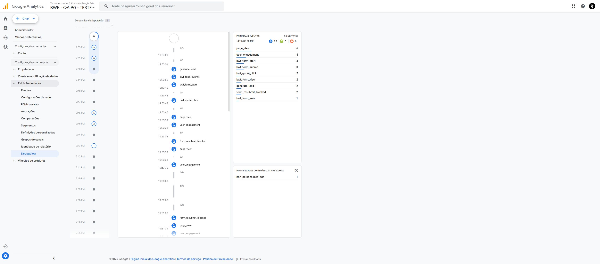

# P0 — publicação QA e coleta direta verificada

Data local: 8 de novembro de 2026 (America/New_York); execução e deploy em 9 de novembro UTC.
Estado: ambiente QA publicado com autorização específica; coleta direta GA4 demonstrada; produção ainda não liberada.

## Ambiente publicado
- URL: https://bwf-p0-qa-20261108.netlify.app
- Projeto Netlify: `bwf-p0-qa-20261108`, ID `c62a6626-686d-47fe-bea3-d7a9c0682366`.
- Deploy pronto: `6af116fa883ac33a58543b4e`; publicado em `2026-11-09T00:42:43.102Z`.
- Branch de artefato: `qa/p0-browser-preview`; commit `973d9c902e9aab63d574fb93b0fe057a203b7db2`.
- Esta branch contém somente a cópia gerada, mais `.gitignore`, e **não deve ser mesclada em main ou na P0**.
- Destino Google: propriedade QA `563205212`, medição `G-21MY7L42JP`. Tag Assistant reconheceu também o contêiner `GTM-M7QTNQ2N`.
- POSTs continuam simulados em memória. Sem funções, backend de armazenamento ou notificações. Nenhum formulário real foi enviado.
- A tentativa inicial de upload pelo navegador não concluiu; a publicação foi feita pela integração GitHub existente, no projeto QA previamente criado. Nenhum novo projeto duplicado foi criado.

## Fatos verificados diretamente
A sessão usou o Chrome conectado do usuário, em HTTPS público. Não houve relay curl nem interceptação do tráfego Google nesta etapa. O Tag Assistant reconheceu a tag QA; os eventos e parâmetros abaixo foram lidos no **DebugView da propriedade QA**, demonstrando processamento além de uma simples resposta HTTP.

1. Home: clique em orçamento, formulário visível, preenchimento fictício e tentativa com HTTP 500 simulado; `bwf_form_error` apareceu no DebugView, sem lead de sucesso nessa tentativa.
2. O alerta nativo de erro interrompeu a automação. Houve solicitação para fechá-lo e posterior recarga da página antes de continuar. A recuperação de erro sem recarga **não foi validada conclusivamente** nesta sessão.
3. Home após recarga: sucesso simulado, confirmação visual e um `generate_lead`.
4. Recarga após sucesso: confirmação de pedido já realizado, `form_resubmit_blocked` e nenhum novo lead.
5. Navegação para cozinhas: o bloqueio compartilhado da home foi preservado, com outro `form_resubmit_blocked`.
6. Reinício explícito do estado QA pelo botão do painel, seguido de preenchimento fictício e sucesso simulado de cozinhas: confirmação visual e segundo `generate_lead`.
7. Um Voltar removeu o fragmento da URL de cozinhas e manteve a confirmação. **Isso não constitui teste de BFCache entre páginas nem Safari físico.**

### Contagem observada
A captura final do DebugView, antes de novos testes, mostrou **25 eventos nos últimos 30 minutos**:

| Evento | Quantidade |
| --- | ---: |
| page_view | 6 |
| user_engagement | 4 |
| bwf_form_start | 3 |
| bwf_form_submit | 3 |
| bwf_quote_click | 2 |
| bwf_form_view | 2 |
| generate_lead | 2 |
| form_resubmit_blocked | 2 |
| bwf_form_error | 1 |

É uma contagem da janela observada no DebugView, não o total histórico da propriedade nem número de pedidos reais. Não somar automaticamente aos 38 eventos sintéticos do ensaio anterior por relay. Os sete tipos de evento P0 estão presentes. A sequência rápida de cozinhas usou o botão de preenchimento QA; não foi isolado um novo `bwf_form_view` dessa página nesta sessão.

### Parâmetros do lead conferidos no GA4

| Parâmetro | Home | Cozinhas |
| --- | --- | --- |
| form_id | bwf-quote | bwf-kitchen-quote |
| page_type | home | kitchens |
| service_group | custom_millwork | custom_cabinetry |
| page_location | https://bwf-p0-qa-20261108.netlify.app/ | https://bwf-p0-qa-20261108.netlify.app/custom/kitchens |

Na home também foram abertos e conferidos `debug_mode=1` e `funnel_version=p0_v1`. Os parâmetros de erro, motivo de bloqueio e todos os CTAs ainda não foram expandidos individualmente no DebugView desta sessão.

## Preservações
- PR #4 permanece aberto, em rascunho e sem merge.
- A implementação candidata HTML/JS não foi modificada nesta etapa.
- Deploy de produção `brandtwf.com` conferido após a publicação QA: permanece `6ae601f8804528edd98589bf`, estado ready.
- Nenhuma campanha, orçamento, meta, configuração GA4/Ads de produção ou vínculo Ads QA foi alterado.
- Nenhum evento intermediário foi promovido a conversão principal.

## Pendências e próximo ensaio
1. **Safari físico no iPhone**: abrir a URL QA; registrar modelo/iOS/Safari e horário; testar ambos os formulários, CTA, teclado/validação, sucesso, recarga e Voltar entre páginas. Conciliar os eventos QA e a ausência de lead adicional. A proteção de 24h afeta apenas a origem QA; usar Reiniciar teste somente entre cenários planejados.
2. Completar a inspeção dos parâmetros de erro/bloqueio/CTAs e a visualização do formulário de cozinhas com navegação manual pausada. Confirmar recuperação após erro sem recarga.
3. Armazenamento/notificação: a cópia atual não pode verificar esses itens porque simula o backend. Pode-se preparar um backend QA independente, com notificação para endereço de teste previamente definido; isso não comprova o backend de produção.
4. **Envio controlado em produção exige autorização específica**, além da aprovação separada da publicação P0. Proposta: um único pedido claramente marcado `BWF TESTE CONTROLADO P0 <data-hora>`, com endereço de contato de teste definido antes da execução. Registrar origem, horário e formulário; conciliar ID/status/classificação da submissão no Netlify, recebimento da notificação e um `generate_lead` no GA4 correto. Não enviar enquanto esses dados e o destino não estiverem definidos e autorizados.
5. Ads: manter `generate_lead` como principal importado do GA4. Conferir vínculo, ação e configuração por leitura; a prova de atribuição/importação requer uma conversão elegível observada. Não fabricar gclid, clicar anúncio próprio para produzir atribuição nem importar leads QA na conta real. Uma submissão orgânica de teste isolada não demonstra atribuição Ads.

**Recomendação:** manter P0 em rascunho, sem merge/publicação em `brandtwf.com`, até resolver Safari/BFCache e a conciliação externa. A publicação QA e os resultados acima não autorizam publicação principal.
