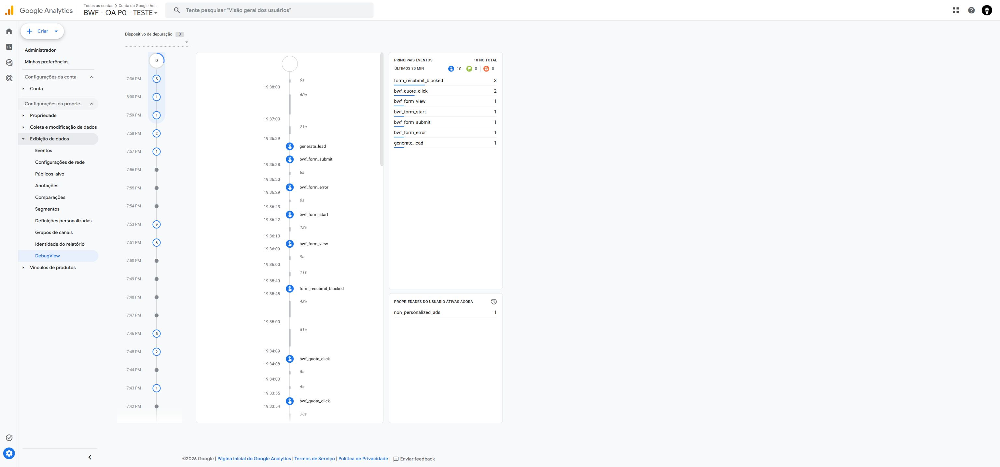

# P0 — relato Safari e conferência de eventos em 09/11/2026

Data local: 09/11/2026 (America/New_York); conferência aproximadamente às 19:38–19:40.
Ambiente: https://bwf-p0-qa-20261108.netlify.app
GA4 QA: propriedade 563205212, medição G-21MY7L42JP.

## Resultado reportado pelo usuário
Após a orientação para reiniciar o teste QA e enviar uma vez, o usuário informou: “feito, e no safara tb esta legal”. Antes, relatou que todos os links funcionaram. Isso registra funcionamento percebido no Safari, sem substituir a conferência independente de cada cenário. O modelo do aparelho, versão iOS/Safari, formulário usado no Safari e a sequência exata de recarga/Voltar não foram informados.

## Verificação direta no GA4
A aba DebugView permaneceu aberta desde o ensaio anterior, com um evento antigo selecionado e a linha do tempo pausada. Fechar o detalhe retomou a visualização e revelou os eventos recentes abaixo. Nenhum novo envio foi executado pelo assistente nesta conferência.

| Evento | Contagem na janela observada |
| --- | ---: |
| form_resubmit_blocked | 3 |
| bwf_quote_click | 2 |
| bwf_form_view | 1 |
| bwf_form_start | 1 |
| bwf_form_submit | 1 |
| bwf_form_error | 1 |
| generate_lead | 1 |
| **Total** | **10** |

A janela do painel indica últimos 30 minutos; não é total histórico, nem prova de cobertura de todos os dispositivos. O seletor mostrava zero dispositivos ativos. Não foi possível atribuir especificamente os eventos ao Safari. Existe um único lead na janela observada; isso não demonstra ausência de duplicação em sessões ou dispositivos não identificados.

Sequência exibida:
- 19:36:09 — visualização do formulário.
- 19:36:22 — início.
- 19:36:29 — erro.
- 19:36:38 — tentativa de envio.
- 19:36:39 — generate_lead.

Parâmetros abertos no evento de erro:
- error_type = validation
- error_code = required
- field_name = project-type
- form_id = bwf-quote

Logo, esse registro sinaliza campo obrigatório de tipo de projeto, não falha de rede/servidor. O envio com sucesso apareceu depois. Essa sequência não encerra a pendência anterior de recuperação após HTTP 500 com alerta nativo.

Parâmetros abertos no generate_lead:
- form_id = bwf-quote
- page_type = home
- service_group = custom_millwork
- page_location = https://bwf-p0-qa-20261108.netlify.app/

Os bloqueios vistos não foram individualmente conciliados com um envio/recarga/Voltar posterior. Não inferir que três bloqueios comprovam três tentativas de envio.

## Estado e pendências
- PR #4 conferido aberto, draft, sem merge; código candidato P0 não alterado nesta rodada.
- Não houve publicação principal, alteração de GA4/Ads de produção, campanha ou orçamento, nem envio real pelo assistente.
- Safari: relato funcional positivo registrado. Correlação dos eventos por aparelho e prova de Voltar/BFCache permanecem pendentes.
- Seguem pendentes os cenários detalhados de erro/visualização de cozinhas e a conciliação externa de armazenamento, notificação e importação Ads.
- Um envio controlado real requer autorização específica e destino/dados de teste previamente definidos; a publicação P0 em produção depende de aprovação separada.
